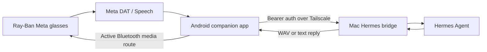

# Ray-Ban Meta Glasses × Hermes

[](https://github.com/Allendior/rayban-meta-glasses-hermes/actions/workflows/ci.yml)
[](LICENSE)
[](https://github.com/Allendior/rayban-meta-glasses-hermes)

Use Ray-Ban Meta glasses as a voice interface for your own [Hermes
Agent](https://github.com/NousResearch/hermes-agent). The Android companion
app receives speech from the glasses, sends the transcript through a private
Tailscale link to a Mac bridge, asks Hermes for an answer, and plays the reply
back through the phone's active Bluetooth audio route.

This is an independent, experimental project. It is not made by, affiliated
with, or endorsed by Meta or Nous Research. It does not replace the glasses'
firmware or bypass Meta's pairing and permission systems.

> **Current status:** the bridge and Android build are working for typed and
> spoken development tests. Meta Device Access Toolkit access, physical
> hands-free input delivery, and audio routing to worn glasses still require a
> real-device test. The default cloned-voice engine is Chatterbox because it
> was more intelligible in testing; OmniVoice remains an optional experiment.

## What this project does

- Connects an Android phone to Meta Wearables Device Access Toolkit (DAT).
- Provides a glasses speech path plus a typed-question fallback.
- Keeps a pure interaction state machine for idle, listening, and busy states.
- Sends final transcripts to a persistent Hermes conversation over Tailscale.
- Supports English, Hindi, and French reply paths.
- Offers fast local Android Text-to-Speech or a cloned-voice WAV response.
- Exposes a small authenticated HTTP API, including an OpenAI-compatible
  adapter for clients such as Visor.
- Keeps Hermes on loopback and limits the phone-facing bridge to loopback or a
  Tailscale IPv4 address.

## Architecture



Meta remains in the glasses pairing and DAT/Speech path. Hermes remains in
whatever model-provider path its own configuration uses. The bridge is the
private adapter between those systems; it is not a local replacement for
Meta's firmware or Hermes' model provider.

## Requirements

- Ray-Ban Meta or compatible Meta AI glasses and an Android phone.
- The Meta AI app, paired glasses, Developer Mode, and DAT/Speech access for
  the Meta account.
- A Mac running [Hermes Agent](https://github.com/NousResearch/hermes-agent),
  with its API server available on loopback.
- [Tailscale](https://tailscale.com/) signed in on the Mac and phone.
- Python 3.11–3.14 and [`uv`](https://docs.astral.sh/uv/) on the Mac.
- JDK 17 and Android SDK 36 to build the companion app.
- A Meta developer application for real DAT credentials. Development builds
  fall back to `0` values when `android/local.properties` is absent; those
  placeholders can lead to Meta's `DAT_APP_ON_THE_GLASSES_UPDATE_REQUIRED`
  error and are not production credentials.

## Quick start

### 1. Prepare the Mac bridge

Clone the repository and install the locked Python environment:

```sh
git clone https://github.com/Allendior/rayban-meta-glasses-hermes.git
cd rayban-meta-glasses-hermes
uv sync --extra voice --locked
```

Export the same API key used by Hermes. Keep it in a password manager or
private shell environment; do not commit it or paste it into a public issue.

```sh
export API_SERVER_KEY='your-hermes-api-key'
./scripts/configure_target.py \
  --voice-engine chatterbox \
  --reference-audio /absolute/path/to/your-voice.wav
./scripts/run_bridge.sh
```

The configuration script generates a mode-0600 `.env`, preserves a bridge key
across local reconfiguration, and selects the active Tailscale IPv4 address.
For a system-voice-only test, omit `--reference-audio` and use
`TTS_PROVIDER=macos` in `.env`.

Check the bridge from the Mac:

```sh
curl http://127.0.0.1:8788/health
```

To run it as a user LaunchAgent instead of a foreground process:

```sh
./scripts/install_service.sh --dry-run
./scripts/install_service.sh
./scripts/e2e_target_test.sh
```

The service runtime is copied under `~/.local/share/hermes-glasses-bridge` so
macOS background-service permissions do not depend on the checkout location.
Use `./scripts/remove_service.sh` to stop and remove the LaunchAgent; it leaves
the runtime directory and private voice material in place.

### 2. Build the Android companion app

Put real DAT credentials in the ignored `android/local.properties` file:

```properties
mwdat_application_id=your_application_id
mwdat_client_token=your_client_token
```

Then build and test:

```sh
cd android
./gradlew --no-daemon testDebugUnitTest lintDebug assembleDebug
```

The APK is generated at
`android/app/build/outputs/apk/debug/app-debug.apk`. Install it with Android
Studio or `adb install -r`.

### 3. Connect the phone

1. Install Tailscale on the phone and sign in to the same tailnet as the Mac.
2. Pair the glasses in Meta AI and enable Developer Mode.
3. Open Hermes Glasses and enter the Mac's Tailscale address, bridge port, and
   bridge API key. The app stores the key using Android Keystore.
4. Tap **Test Mac bridge**, then **Connect Meta glasses**.
5. Test a typed question first; it isolates the network, Hermes, and audio
   path from DAT hardware behavior.
6. Select **Fast Android voice** for the lowest latency or **Cloned voice** for
   the configured Chatterbox voice.
7. Start glasses listening and test the hands-free interaction with the
   glasses selected as the phone's Bluetooth media output.

The phone UI also includes a recovery action for Meta's
`DAT_APP_ON_THE_GLASSES_UPDATE_REQUIRED` error. It opens Meta's official DAT
glasses-app update flow; it cannot manufacture or bypass Meta credentials.

## Voice engines

### Chatterbox Multilingual v3 — default

The default cloned-voice path uses the pinned MLX Chatterbox Multilingual v3
model. It is the current choice because it produced the clearest speech in
real listening tests with this reference voice. It supports the project's
English, Hindi, and French paths and keeps the model warm in a persistent
worker.

Record a clean reference and benchmark it locally:

```sh
./scripts/record_voice_reference.sh 45
HF_HOME="$PWD/work/voice-models" \
  .venv/bin/python scripts/benchmark_voice.py \
  work/voice-reference/owner-reference.wav \
  --engine chatterbox \
  --output-dir work/benchmarks/chatterbox
```

Voice recordings, model files, generated WAVs, and benchmark output are
ignored by Git. Do not commit them.

### OmniVoice — optional experiment

OmniVoice is included for multilingual experimentation and can be selected with
`--voice-engine omnivoice`. It was faster in warm-worker measurements, but its
pronunciation was not intelligible enough in this deployment to make it the
default. Fewer diffusion steps make it faster but can further reduce quality.

```sh
VOICE_ENGINE=omnivoice ./scripts/install_service.sh
```

This is a reversible deployment choice. Return to the recommended engine with:

```sh
VOICE_ENGINE=chatterbox ./scripts/install_service.sh
```

The [latency notes](docs/CLONED_VOICE_LATENCY.md) record the local measurements
and why intelligibility wins over the fastest synthesis number here.

## Phone-facing API

Every `/v1/*` request requires `Authorization: Bearer <BRIDGE_API_KEY>`.

| Endpoint | Purpose |
| --- | --- |
| `GET /health` | Unauthenticated bridge/Hermes health check |
| `GET /v1/models` | Authenticated Hermes model aliases |
| `POST /v1/turn` | Hermes turn with optional cloned audio |
| `POST /v1/synthesize` | Synthesize a reply directly |
| `POST /v1/transcribe` | Run a configured local STT command |
| `GET /v1/audio/<id>` | Download a generated authenticated WAV |
| `POST /v1/chat/completions` | Non-streaming OpenAI-compatible adapter |

Example:

```sh
curl -H "Authorization: Bearer $BRIDGE_API_KEY" \
  -H 'Content-Type: application/json' \
  -d '{"text":"What is the capital of France?", "language":"en", "speak":true}' \
  http://100.x.y.z:8788/v1/turn
```

`/v1/turn` returns a `session_id`; send it on later turns to continue the
conversation. Supported language codes are `en`, `hi`, and `fr`.

## Security and privacy

- The bridge rejects public plain-HTTP bind addresses; use loopback or a
  Tailscale IPv4 address.
- Hermes is expected to stay on `127.0.0.1`; only the bridge is phone-facing.
- The Android API key is stored with Android Keystore and is not embedded in
  the APK.
- The bridge uses a separate bearer key for phone requests.
- Generated audio is private temporary data and expires after its configured
  TTL. Voice references and model files stay outside version control.
- Local Chatterbox and macOS voices stay on the Mac. Hermes may still use a
  cloud model provider if that is how Hermes is configured.
- Meta's SDK, glasses, and Meta AI app remain subject to Meta's own terms and
  privacy handling.

This project is not automatically an offline or local-only assistant. Inspect
your Hermes model provider, Meta permissions, and model-download settings if
that distinction matters for your deployment.

## Development

Run the dependency-free bridge tests and source checks:

```sh
python3 -m unittest discover -s tests -v
python3 -m compileall -q hermes_voice_bridge scripts tests
```

Run Android verification from `android/`:

```sh
./gradlew --no-daemon testDebugUnitTest
./gradlew --no-daemon lintDebug
./gradlew --no-daemon assembleDebug
```

See [`CONTRIBUTING.md`](CONTRIBUTING.md), [`SECURITY.md`](SECURITY.md), and the
focused notes in [`docs/`](docs/). Keep `.env`, `android/local.properties`,
`work/`, model files, voice recordings, and build output out of commits.

## Project layout

```text
android/              Android companion app and unit tests
hermes_voice_bridge/  Authenticated Mac-side HTTP bridge
scripts/              Setup, service, voice, and end-to-end helpers
tests/                Python bridge tests
docs/                 Architecture, latency, and experimental notes
deploy/               LaunchAgent template for macOS
```

## Roadmap

- Validate hands-free input delivery and Bluetooth audio with glasses worn.
- Measure end-to-end latency across repeated English, Hindi, and French turns.
- Improve streaming or chunked reply playback without sacrificing intelligibility.
- Expand language and local STT coverage.
- Document additional DAT firmware/device compatibility as it is observed.

## License

The original source code is released under the [MIT License](LICENSE). See
[`THIRD_PARTY_NOTICES.md`](THIRD_PARTY_NOTICES.md) for Meta SDK, MLX, model, and
other dependency terms.
